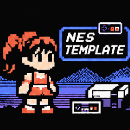
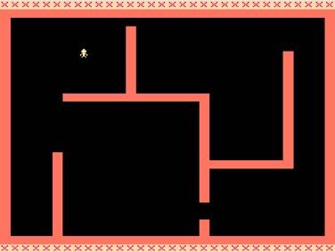

# NES Game Template

>[!NOTE]
> This project is under active development. Features, internal APIs, and
> project structure may change as development progresses.

<br>
*(Image generated by GPT-6.1)*


A lightweight NES game development template written in 6502 Assembly using the
cc65 toolchain.

Most NES tutorials start with a blank screen and require writing a
considerable amount of initialization and hardware setup code before any
gameplay can be implemented.

This template provides a ready-to-build project structure, essential NES
hardware routines, and a working game loop, allowing developers to focus on
game logic instead of repeatedly implementing low-level boilerplate.

## Features

- iNES header and cartridge configuration
- Reset and NMI handlers
- Controller input handling
- OAM DMA transfers
- Palette loading
- Nametable loading
- Sprite and metasprite rendering
- Timer system
- Tile-based collision detection
- Modular source code and build system

A simple demo is included where the player can be moved using the D-pad, with
basic collision detection.



## Requirements

- [cc65](https://cc65.github.io/)
- [GNU Make](https://www.gnu.org/software/make/)

## Build

```
make
```

Build artifacts are saved in the **builds/** directory.

### Make commands

`make` - build ROM.
`make run` - build and run in emulator.
`make clean` - deletes build artifacts and **builds/** directory.
`make simulate` - not used currently in this project, emulate 6502 assembler
  program.

### Make variables and defaults

- `TARGET ?= main` file name of NES ROM output.
- `SRC_DIR ?= src` source files directory.
- `BUILD_DIR ?= build` directory where NES ROM output and compiled object are
  saved.
- `CA65  ?= ca65`  - 6502 Compiler.
- `LD65  ?= ld65`  - 6502 Linker.
- `SIM65 ?= sim65` - 6502 Simulator (not used in this project).
- `SIM_SRC ?= `    - 6502 Simulator input file (not used in this project).

## Project Structure

```
src/
├── core/       Hardware abstraction and low-level NES functionality
├── game/       Game-specific logic
├── gfx/        Graphics and rendering routines
├── include/    Shared constants, macros, and definitions
└── main.s      Main game loop

assets/         CHR graphics and other binary assets
└── patterns.chr

builds/         Build output
```

## Roadmap

Planned features:

- PRG bank switching
- Mapper support
- Sound engine
- Animation system
- Object pool utilities
- Camera and scrolling support

## Development

For a Linux NES development environment setup guide, see:
[Setting up NES Development on GNU/Linux](https://www.whoop.ee/post/nes-development-on-linux.html).

Also, if you are interested in NES and 6502 assembler development, I would like
to recommend checking my [nes.nvim](https://github.com/dknight/nes.nvim/)
plugin for Neovim.

## License

- MIT
- NES/Famicom is a trademark of [Nintendo Co., Ltd](https://www.nintendo.com/).

