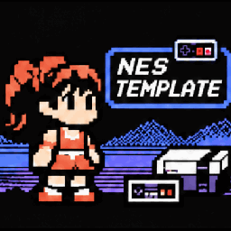
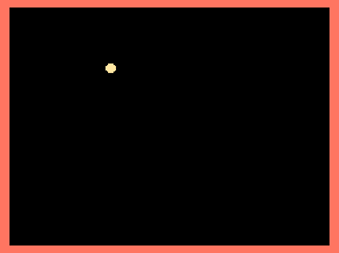

# NES Game Template

<br>
*(Image generated by GPT-6.1)*


Most tutorials start with a blank screen and require writing a large amount of setup code before any gameplay can be implemented.

The template provides a clean project structure and a working game loop so developers can immediately focus on writing game logic instead of hardware initialization.

## Features

- iNES header
- Reset and NMI handlers
- Controller input
- OAM DMA
- Palette loading
- Nametable loading
- Sprites and meta-sprites rendering
- Timer system
- Modular project layout and compilation
- Collision helpers

A simple demo is included where the player sprite can be moved with the D-pad.



Also check setup NES develop for GNU Linux [setup](https://www.whoop.ee/post/nes-development-on-linux.html).

## Build and run

Dependencies `cc65` and `make`.

Build, just:

```
make
```

Builds are saved in the `builds/` directory.

## Project Structure and Architecture

```
src/
    core/             Hardware abstraction and low-level NES functionality.
    game/             Game-specific logic.
    gfx/              Everything related to rendering.
    include/          Common include files.
    main.s            Main game loop.
builds/               Builds output.
assets/               CHR graphics and other binary assets.
    patterns.chr
```

## Roadmap

Planned features:

- PRG bank switching
- Mapper support
- Sound engine
- Animation system
- Object pool utilities
- Camera support

## License

- MIT
- NES/Famicom is a trademark of Nintendo Co., Ltd.
